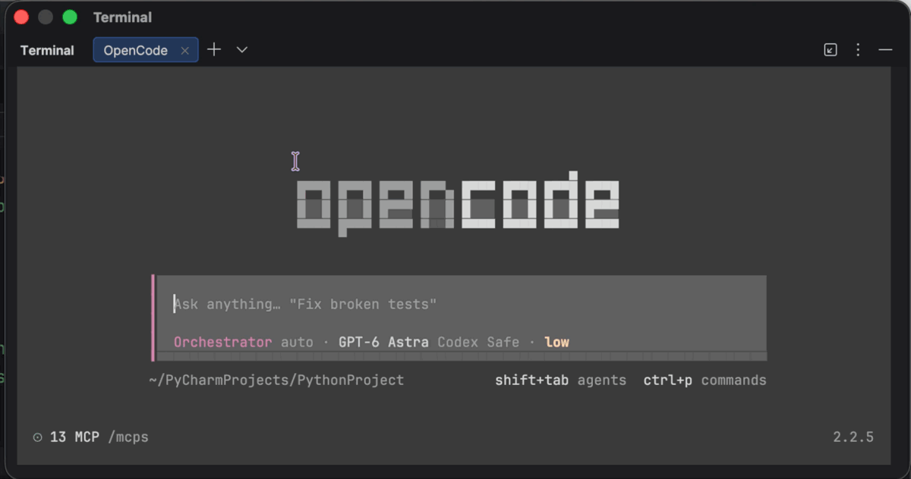

# opencode-attention-plus

[Русский](README.ru.md)

A TUI plugin for OpenCode that notifies you about questions, permission requests, completion, and errors. Banners appear in the background; sound does not depend on focus. The default delay is 2 seconds.

Experimental version 0.1.1. Compatibility: OpenCode 2.2.5. Uses the public SDK without core modifications.

## Demo

A question notification on macOS while OpenCode is in the background. Silent recording.



## Installation

npm installation, in a dedicated directory:

```sh
mkdir -p "$HOME/.local/share/opencode-attention-plus-install"
cd "$HOME/.local/share/opencode-attention-plus-install"
npm install --ignore-scripts opencode-attention-plus@0.1.1
```

This release is experimental. npm tags such as `latest` and `next` can point to different versions and do not guarantee stability. Pin `0.1.1` as above for reproducible installation.

Use the absolute installed package path, such as `/Users/your-name/.local/share/opencode-attention-plus-install/node_modules/opencode-attention-plus`, in `cli.json` below. A [tarball installation](docs/releasing.md#install-the-tarball) is also supported.

Alternatively, build from a source checkout:

Building requires Node.js with `--experimental-strip-types` support and npm.

```sh
npm ci --ignore-scripts
npm run build
```

Add the package directory to `cli.json`. Example for macOS with a terminal inside PyCharm:

```json
{
  "plugins": [
    "-opencode.notifications",
    {
      "package": "/absolute/path/opencode-attention-plus",
      "options": {
        "notificationBackend": "macos-fallback",
        "nativeNotifications": true,
        "macosHostBundleId": "com.jetbrains.pycharm"
      }
    }
  ]
}
```

Use an absolute path to the package directory, not `dist/tui.js`. Keep your other plugins and settings. The `-opencode.notifications` entry disables the built-in handler to avoid duplicate notifications.

Restart the TUI after adding or updating the package. Rebuild after source changes. See the [release guide](docs/releasing.md) for tarball installation.

For the standard terminal backend, use `{"package": "/absolute/path/opencode-attention-plus"}` without `options`. Banner availability depends on the terminal and OpenCode.

## Behavior

- Questions and permissions notify after the delay. Answering or cancelling the form before then removes the pending signal.
- Completion waits for the root session, its descendants, and responses to open requests.
- An error in the root or a descendant changes the final signal to an error.
- A new run cancels stale completion signals. Restarting a parent does not cancel notifications for its descendants' requests.
- An interruption suppresses completion and cancels pending notifications in the affected subtree. It does not mark the request as answered.
- Duplicate events are suppressed within the current plugin instance.

## Options

Pass these in the plugin entry's `options` object.

| Option | Default | Description |
| --- | --- | --- |
| `enabled` | `true` | Enables the plugin; `false` disables both channels |
| `delayMs` | `2000` | Delay in milliseconds; a finite, nonnegative number |
| `language` | `auto` | Message language: `auto`, `en`, or `ru` |
| `notificationBackend` | `terminal` | Standard `terminal` or native `macos-fallback` backend |
| `nativeNotifications` | `false` | Allows native macOS banners independently of SDK banner settings |
| `macosHostBundleId` | Unset | Bundle ID of the app hosting the TUI; required for `macos-fallback` |

Invalid values for known options cause a load error. Unknown fields are ignored.

`auto` reads the first macOS preferred system language once when the plugin starts; other platforms use the runtime's `Intl` locale. Russian locales use Russian messages; other languages, missing values, and lookup failures fall back to English. The macOS lookup starts immediately and has a 1-second timeout. An unusually early notification may wait for this one-time lookup; cancelled requests are not delivered afterward. Restart the TUI after changing the system language.

To force English (for example, for a demo), add `"language": "en"` to the plugin's `options`. `"language": "ru"` preserves Russian messages. Explicit choices skip system-language detection. Both notification backends use the same translated messages; titles and sound names are unchanged.

### Native macOS banners

Despite its name, `macos-fallback` is a separate backend, not a retry after a standard notification. It requires explicit `nativeNotifications` opt-in.

- A banner is sent only when `macosHostBundleId` is not the active app. Focus is app-wide, not per tab or project.
- `attention.notifications: false` does not disable native banners. Use `nativeNotifications: false` instead.
- OpenCode still controls sound, including its sound settings, volume, and sound files.
- Unknown focus or a failed focus check suppresses the banner. macOS notification permissions and Focus modes may prevent display.
- Other operating systems use the standard terminal backend.

## Troubleshooting

- No native banner: check `enabled`, `notificationBackend`, `nativeNotifications`, and the host app's bundle ID. Switch to a different app, wait for the delay, and check macOS notification permissions and Focus settings.
- Another tab or project does not count as a different app for native focus checks.
- No sound: check OpenCode's SDK sound settings and volume. Native banner opt-in does not enable SDK sound.
- Changes have no effect: rebuild source changes and restart the TUI. Check that `cli.json` points to the package directory.

## Limitations

- Reloading the plugin resets deduplication history; already-open requests are not restored.
- Events missed during a connection loss can result in missed notifications.
- There is no deduplication across multiple TUIs. Session state is retained until the plugin unloads.
- Notifications already accepted by the system cannot be recalled. The delay controls submission, not the exact display time.
- Other OpenCode versions and some complex scenarios need further verification: see the [coverage matrix](docs/verification.md).

## Design decisions

Delayed requests avoid stale prompts; completion waits for the session family and open requests.
Cancellation stops pending work, not notifications already accepted by the OS. Native macOS banners require explicit opt-in; sound stays with the SDK.
See [the design notes](docs/design.md) for the problems, decisions, and tradeoffs.

## Development

```sh
npm test
npm run typecheck
ATTENTION_PACK_TEST=1 npm test
```

The last command also checks packaging and installation with the real SDK. Public package export: `opencode-attention-plus/tui`.

- [Contributing](CONTRIBUTING.md)
- [Security reports](SECURITY.md)
- [Verification and coverage](docs/verification.md)
- [Build, release, and rollback](docs/releasing.md)
- [Changelog](CHANGELOG.md)

## Origins

Notification behavior was inspired by [oh-my-openagent](https://github.com/code-yeongyu/oh-my-openagent). This package evolved from a local replacement implementation, later ported to the OpenCode TUI.

The plugin uses OpenCode's public SDK. OpenCode is available under the [MIT license](https://github.com/anomalyco/opencode/blob/dev/LICENSE).

## License

[MIT](LICENSE), copyright 2026 Mikhail Belyakov.
