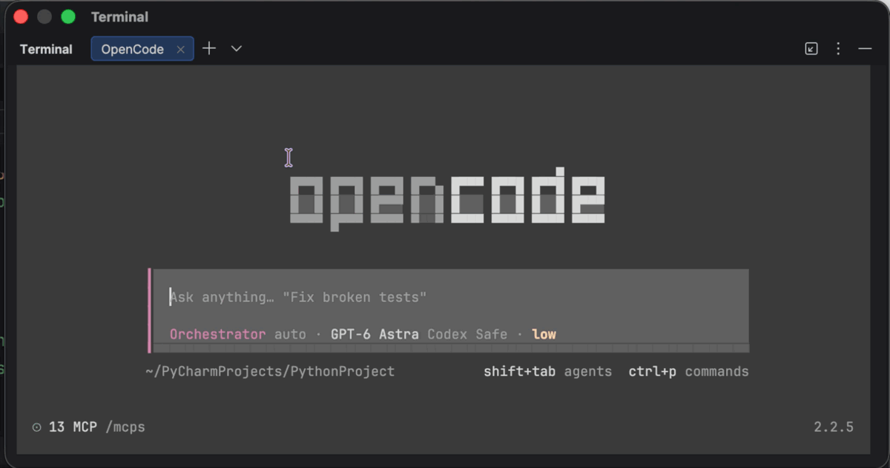

# opencode-attention-plus

[English](README.md)

TUI-плагин для OpenCode: уведомляет о вопросах, запросах разрешения, завершении работы и ошибках. Баннеры появляются в фоне, звук не зависит от фокуса. Задержка по умолчанию - 2 секунды

Экспериментальная версия 0.1.1. Совместимость: OpenCode 2.2.5. Плагин использует публичный SDK и не требует изменений ядра

## Демо

Уведомление о вопросе в macOS, пока OpenCode находится в фоне. Запись без звука



## Установка

Установка из npm в отдельный каталог:

```sh
mkdir -p "$HOME/.local/share/opencode-attention-plus-install"
cd "$HOME/.local/share/opencode-attention-plus-install"
npm install --ignore-scripts opencode-attention-plus@0.1.1
```

Этот выпуск экспериментальный. Метки npm, например `latest` и `next`, могут указывать на разные версии и не гарантируют стабильность. Для воспроизводимой установки фиксируйте `0.1.1`, как в команде выше

В `cli.json` ниже укажите абсолютный путь установленного пакета, например `/Users/your-name/.local/share/opencode-attention-plus-install/node_modules/opencode-attention-plus`. Также доступна [установка из tarball](docs/releasing.md#install-the-tarball)

Другой вариант - сборка из каталога исходников:

Для сборки нужен Node.js с поддержкой `--experimental-strip-types` и npm

```sh
npm ci --ignore-scripts
npm run build
```

Добавьте в `cli.json` путь к каталогу пакета. Пример для macOS и терминала внутри PyCharm:

```json
{
  "plugins": [
    "-opencode.notifications",
    {
      "package": "/absolute/path/opencode-attention-plus",
      "options": {
        "notificationBackend": "macos-fallback",
        "nativeNotifications": true,
        "macosHostBundleId": "com.jetbrains.pycharm"
      }
    }
  ]
}
```

Используйте абсолютный путь к каталогу, не к `dist/tui.js`. Сохраните остальные плагины и настройки своего файла. Запись `-opencode.notifications` отключает штатный обработчик, чтобы два плагина не отправляли одинаковые уведомления

Перезапустите TUI после подключения или обновления пакета. После изменений исходников повторите сборку. Установка из tarball описана в [инструкции выпуска](docs/releasing.md)

Для штатного терминального канала достаточно записи `{"package": "/absolute/path/opencode-attention-plus"}` без `options`. Доступность баннеров в этом режиме зависит от терминала и OpenCode

## Поведение

- Вопросы и разрешения уведомляют только после задержки. Быстрый ответ или отмена формы убирают ожидающий сигнал
- Итоговое уведомление ждёт завершения корневой сессии, её потомков и ответа на открытые запросы
- Ошибка корня или потомка меняет итоговый сигнал на ошибку
- Новый запуск отменяет устаревший итоговый сигнал. Запуск родителя не отменяет уведомления о запросах потомков
- Прерывание не отправляет итоговый сигнал и отменяет ожидающие уведомления соответствующего поддерева. Сам запрос при этом не считается отвеченным
- Повторные события подавляются в пределах текущего экземпляра плагина

## Настройки

Параметры передаются в `options` записи плагина

| Параметр | По умолчанию | Описание |
| --- | --- | --- |
| `enabled` | `true` | Включает плагин; `false` отключает оба канала |
| `delayMs` | `2000` | Задержка в миллисекундах, конечное неотрицательное число |
| `language` | `auto` | Язык сообщений: `auto`, `en` или `ru` |
| `notificationBackend` | `terminal` | Штатный канал `terminal` или нативный `macos-fallback` |
| `nativeNotifications` | `false` | Разрешает нативные баннеры macOS независимо от настроек баннеров SDK |
| `macosHostBundleId` | Не задан | Bundle ID приложения с TUI; обязателен для `macos-fallback` |

Неверные значения известных параметров вызывают ошибку загрузки. Неизвестные поля игнорируются

`auto` один раз при запуске плагина читает первый предпочитаемый системный язык macOS; на других ОС используется локаль среды выполнения из `Intl`. Для русской локали сообщения русские; для остальных языков, пустого значения или ошибки определения - английские. Запрос языка macOS начинается сразу и ограничен таймаутом 1 секунда. Очень раннее уведомление может дождаться этого единственного запроса; отменённые запросы после ожидания не доставляются. После смены системного языка перезапустите TUI

Чтобы принудительно включить английский, например для демо, добавьте `"language": "en"` в `options` плагина. Значение `"language": "ru"` сохраняет русские сообщения. Явный выбор отключает определение системного языка. Оба канала используют одинаковые переводы; заголовок и имена звуков не меняются

### Нативные баннеры macOS

Несмотря на имя `macos-fallback`, это отдельный канал, а не повторная попытка после штатного уведомления. Для него нужно явно включить `nativeNotifications`

- Баннер показывается, только когда приложение `macosHostBundleId` неактивно. Фокус учитывается для всего приложения, не для отдельной вкладки или проекта
- `attention.notifications: false` не отключает нативные баннеры. Для их отключения установите `nativeNotifications: false`
- Звук остаётся под управлением OpenCode: действуют его настройки звука, громкости и звуковых файлов
- При неизвестном фокусе или ошибке проверки баннер не отправляется. Разрешения уведомлений macOS и режим фокусирования могут блокировать показ
- На других ОС используется штатный терминальный канал

## Если уведомления не работают

- Нет нативного баннера: проверьте `enabled`, `notificationBackend`, `nativeNotifications` и bundle ID приложения с TUI. Переключитесь в другое приложение, дождитесь задержки и проверьте разрешения уведомлений macOS и режим фокусирования
- Другая вкладка или проект не считаются другим приложением при проверке фокуса нативного канала
- Нет звука: проверьте настройки звука SDK OpenCode и громкость. Разрешение нативных баннеров не включает звук SDK
- Изменения не применились: пересоберите изменённые исходники и перезапустите TUI. Проверьте, что `cli.json` указывает на каталог пакета

## Ограничения

- После перезагрузки плагина история дедупликации сбрасывается; уже открытые запросы не восстанавливаются
- События, пропущенные при разрыве соединения, могут привести к пропущенному уведомлению
- Дедупликация между несколькими TUI не реализована. Состояние сессий хранится до выгрузки плагина
- Уже принятое системой уведомление отозвать нельзя. Задержка задаёт время отправки, а не точный момент показа баннера
- Совместимость с другими версиями OpenCode и часть сложных сценариев требуют дополнительной проверки: [матрица покрытия](docs/verification.md)

## Почему так устроено

Задержка запросов убирает устаревшие сигналы; завершение ждёт семью сессий и ответы на открытые запросы.
Отмена останавливает ожидающую работу, но не отзывает принятые ОС уведомления. Нативные баннеры macOS требуют явного согласия, звук остаётся в SDK.
Проблемы, решения и компромиссы описаны в [заметках об устройстве](docs/design.md)

## Разработка

```sh
npm test
npm run typecheck
ATTENTION_PACK_TEST=1 npm test
```

Последняя команда также проверяет упаковку и установку с настоящим SDK. Публичный экспорт пакета: `opencode-attention-plus/tui`

- [Участие в разработке](CONTRIBUTING.md)
- [Сообщения об уязвимостях](SECURITY.md)
- [Проверки и покрытие](docs/verification.md)
- [Сборка, выпуск и откат](docs/releasing.md)
- [История изменений](CHANGELOG.md)

## Происхождение

Поведение уведомлений вдохновлено [oh-my-openagent](https://github.com/code-yeongyu/oh-my-openagent). Пакет вырос из локальной реализации на замену, позже перенесённой в OpenCode TUI

Плагин использует публичный SDK OpenCode. OpenCode распространяется под [лицензией MIT](https://github.com/anomalyco/opencode/blob/dev/LICENSE)

## Лицензия

[MIT](LICENSE), copyright 2026 Mikhail Belyakov
